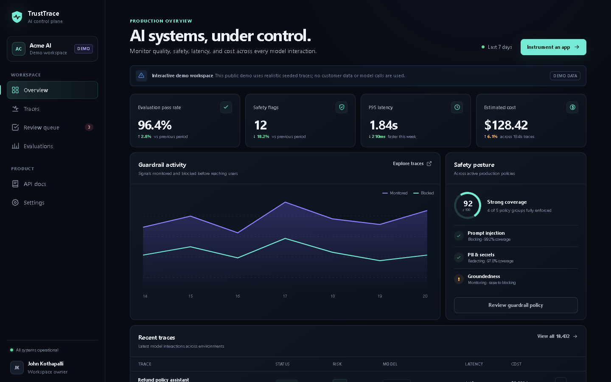

# TrustTrace

[](https://github.com/Johnkothapalli/trusttrace-ai/actions/workflows/ci.yml)
[](LICENSE)

TrustTrace is an explainable AI reliability and security operations dashboard. It helps engineering teams inspect LLM traces, detect deterministic safety and privacy signals, compare evaluation runs, and route risky output to a human review queue.

> **Portfolio project:** The included data is synthetic and the rule-based guardrails are intentionally described as deterministic checks—not as a trained AI safety model.



## What it demonstrates

- A production-shaped Next.js and TypeScript dashboard with responsive, accessible UI
- A FastAPI service with typed contracts, pagination, authentication, and OpenAPI documentation
- PostgreSQL persistence through SQLAlchemy, with a zero-config SQLite development fallback
- Explainable prompt-injection, PII, credential, and unsafe-output checks
- Human review workflow and append-only audit events
- Automated frontend and backend quality gates in GitHub Actions
- Docker Compose setup for a complete local environment

## Architecture

```text
Next.js dashboard
       |
       | REST / JSON
       v
FastAPI service ---- deterministic guardrail engine
       |
       v
PostgreSQL (SQLite fallback)
```

The public dashboard can fall back to clearly labelled synthetic demo data when no API URL is configured. The full ingestion and review workflow runs locally through the API.

## Quick start

### Docker Compose

```bash
cp .env.example .env
docker compose up --build
```

Open:

- Dashboard: `http://localhost:3000`
- API documentation: `http://localhost:8000/docs`
- API health: `http://localhost:8000/health`

### Run without Docker

Backend:

```bash
cd api
python -m venv .venv
source .venv/bin/activate  # Windows: .venv\Scripts\activate
pip install -e ".[dev]"
uvicorn app.main:app --reload
```

Frontend:

```bash
cd web
npm install
npm run dev
```

## Ingest a trace

```bash
curl -X POST http://localhost:8000/api/v1/traces \
  -H "Content-Type: application/json" \
  -H "X-TrustTrace-Key: tt_demo_ingest_change_me" \
  -d '{
    "external_id": "support-summary-001",
    "model": "gpt-5-mini",
    "provider": "openai",
    "prompt": "Summarize this support request without personal data.",
    "response": "The customer needs help resetting an account password.",
    "latency_ms": 842,
    "input_tokens": 18,
    "output_tokens": 12,
    "estimated_cost_usd": 0.00008
  }'
```

TrustTrace stores only the fields submitted to it. Never send production secrets or sensitive customer data to a demo environment.

## Quality checks

```bash
cd api
ruff check .
ruff format --check .
pytest -W error --cov=app --cov-report=term-missing --cov-fail-under=90

cd ../web
npm audit --omit=dev
npm test
npm run lint
npm run typecheck
npm run build
```

Current verified baseline: 20 backend tests with 95% coverage, 3 formatting utility tests,
warnings-as-errors, clean lint and formatting, a Node 22 production build, and no known npm or
Python dependency vulnerabilities.

## Security model

- Write operations require separate ingestion or administrator API keys.
- Non-demo keys come from environment variables; committed values are deliberately non-secret demo keys.
- Findings include the matching rule, severity, confidence, and redacted evidence.
- The demo is not a replacement for a dedicated DLP, identity, or policy system.

See [the product brief](docs/PRODUCT_BRIEF.md), [architecture notes](docs/ARCHITECTURE.md),
[threat model](docs/THREAT_MODEL.md), and [SECURITY.md](SECURITY.md) for the product rationale
and deployment guidance.

## License

[MIT](LICENSE)
